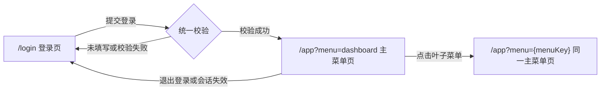

# 广告多租户平台：登录与主菜单简化交互设计

## 1. 设计范围

参考优量汇、字节穿山甲等广告平台后台的简洁企业级风格，本方案仅包含：

1. 邀请制登录页。
2. 登录成功后的主菜单页。

不包含注册、找回密码及菜单项下的业务子页面。菜单点击仅切换选中状态和占位内容。

默认按桌面端设计。邀请码用于准入校验，账号密码用于身份认证，全部通过后才建立登录会话。

## 2. 页面清单

| 编号 | 页面 | 建议路由 | 页面职责 | 访问条件 |
| --- | --- | --- | --- | --- |
| P01 | 邀请制登录页 | `/login` | 校验邀请码、账号和密码 | 未登录用户 |
| P02 | 主菜单页 | `/app` | 展示租户信息、后台导航和模块占位内容 | 有效登录会话 |

## 3. 页面元素与字段

### 3.1 P01：邀请制登录页

**页面标题：** `{平台名称}`  
**辅助说明：** `多租户广告管理平台，仅限受邀用户登录`

| 元素 | 字段名 | 是否必填 | 规则与占位文案 |
| --- | --- | --- | --- |
| 邀请码输入框 | `inviteCode` | 是 | 去除首尾空格；占位「请输入邀请码」 |
| 登录账号输入框 | `account` | 是 | 支持邮箱或手机号；占位「请输入登录账号」 |
| 密码输入框 | `password` | 是 | 默认掩码，可切换显示；占位「请输入密码」 |
| 登录按钮 | — | — | 默认「登录」；请求中显示「登录中…」并禁用 |
| 状态提示 | — | — | 字段错误显示在对应输入框下方；成功提示放在按钮上方 |
| 辅助说明 | — | — | 「没有邀请码？请联系邀请人或平台管理员」 |

邀请码的有效性、有效期、使用状态及绑定租户均由服务端判断，前端不硬编码有效邀请码。

### 3.2 P02：主菜单页

| 区域 | 元素 | 交互说明 |
| --- | --- | --- |
| 左侧导航 | 平台标识、分组菜单、当前选中项 | 父级菜单用于展开或收起；叶子菜单用于切换选中状态 |
| 顶部栏 | 当前租户、用户角色、账号名称、退出登录 | 展示当前登录上下文 |
| 租户切换 | 租户下拉框 | 仅用户属于多个租户时显示；切换后重新获取菜单并回到工作台 |
| 内容区域 | 当前菜单标题、占位卡片 | 不实现具体业务内容 |

**视觉建议：**

- 浅色内容区、白色导航，品牌蓝作为主色。
- 左侧导航建议宽 `216px`，顶部栏建议高 `56px`。
- 使用简洁边框和状态色，不加入复杂插画或营销式布局。

## 4. 交互状态与反馈

登录采用一次提交、统一校验，不增加邀请码单独验证步骤。

| 状态 | 触发条件 | 页面反馈 | 后续行为 |
| --- | --- | --- | --- |
| 默认 | 首次进入 | 表单项为空，不展示错误 | 等待输入 |
| 邀请码未填写 | 点击登录时邀请码为空 | 输入框红色描边；提示「请输入邀请码」 | 聚焦邀请码，不发起请求 |
| 账号未填写 | 点击登录时账号为空 | 提示「请输入登录账号」 | 聚焦账号输入框，不发起请求 |
| 密码未填写 | 点击登录时密码为空 | 提示「请输入密码」 | 聚焦密码输入框，不发起请求 |
| 邀请码无效 | 服务端返回无效、过期或不可用 | 提示「邀请码无效或已失效，请检查后重试」 | 停留登录页，保留已填内容 |
| 校验成功 | 邀请码及账号密码均通过 | 绿色提示「校验通过，正在进入后台…」 | 建立会话并进入主菜单 |
| 账号认证失败 | 账号或密码不匹配 | 提示「账号或密码错误」 | 停留登录页 |
| 请求异常 | 网络或服务异常 | 提示「服务暂时不可用，请稍后重试」 | 恢复按钮，可重新提交 |

补充规则：

- 点击「登录」时统一检查必填项，并优先聚焦首个错误字段。
- 用户修改输入后，清除对应字段的旧错误。
- 请求期间禁用登录按钮，避免重复提交。
- 邀请码不可用与账号密码错误使用不同反馈，网络异常不得显示为邀请码无效。
- 无权限菜单不渲染；菜单数据由后端按租户和角色返回。

## 5. 页面跳转关系



| 当前位置 | 操作或条件 | 跳转结果 |
| --- | --- | --- |
| `/login` | 必填或邀请码校验失败 | 留在 `/login` |
| `/login` | 登录成功 | 使用 `replace` 进入 `/app?menu=dashboard` |
| `/login` | 已存在有效会话 | 直接进入 `/app?menu=dashboard` |
| `/app` | 无会话或会话失效 | 跳转 `/login` |
| `/app` | 退出登录 | 清除会话并返回 `/login` |
| `/app` | 点击父级菜单 | 只展开或收起，不跳转 |
| `/app` | 点击叶子菜单 | 更新为 `/app?menu={menuKey}`，仍使用主菜单页 |
| `/app` | 切换租户 | 重新加载权限菜单，回到 `dashboard` |

菜单参数无效时回退到 `dashboard`，不额外制作错误页面。

## 6. 菜单结构及占位文案

### 6.1 菜单结构

```text
工作台                         dashboard

广告业务
├─ 广告主管理                  advertisers
├─ 媒体与广告位                media-placements
├─ 投放管理                    campaigns
└─ 素材中心                    creatives

数据中心
├─ 投放报表                    delivery-reports
└─ 收益报表                    revenue-reports

财务中心
└─ 对账与结算                  finance-settlement

租户与权限
├─ 租户管理                    tenants
└─ 成员与角色                  members-roles

系统设置
└─ 基础配置                    system-settings
```

权限说明：

- 「租户管理」默认仅平台管理员可见。
- 「成员与角色」可按租户管理员权限开放。
- 其他菜单根据租户类型和用户角色由后端配置返回。

### 6.2 主内容区统一占位

| 元素 | 占位文案 |
| --- | --- |
| 页面标题 | 「{当前菜单名称}」 |
| 占位卡片标题 | 「{当前菜单名称}」 |
| 通用占位说明 | 「该模块页面待接入，当前仅用于展示后台导航与选中状态。」 |
| 工作台默认说明 | 「欢迎进入{平台名称}，请选择左侧菜单。」 |

## 7. 最小开发约定

- 登录接口建议：`POST /auth/login`。
- 请求字段：`inviteCode`、`account`、`password`。
- 登录成功后返回会话信息、当前租户、用户角色及可访问菜单。
- 建议错误码：`INVITE_INVALID`、`AUTH_FAILED`；必填错误由前端本地处理。
- 主菜单页通过会话守卫控制访问，不能仅依赖前端隐藏登录页或菜单项。
- 后续业务页面可按 `menuKey` 逐项替换主内容区占位组件。
